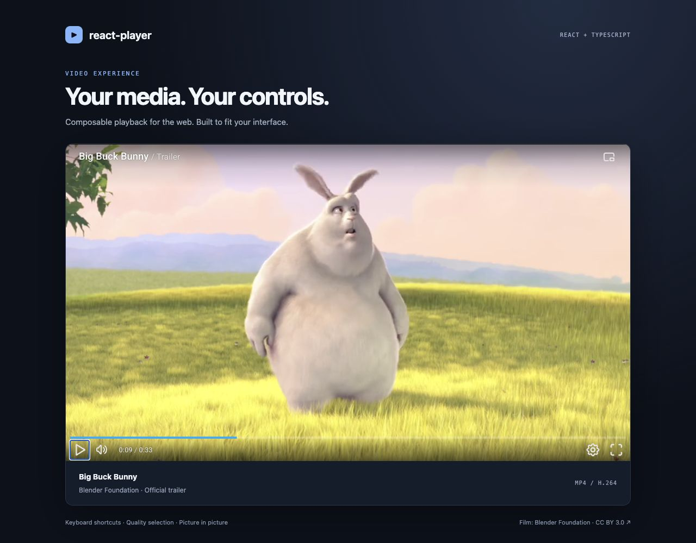
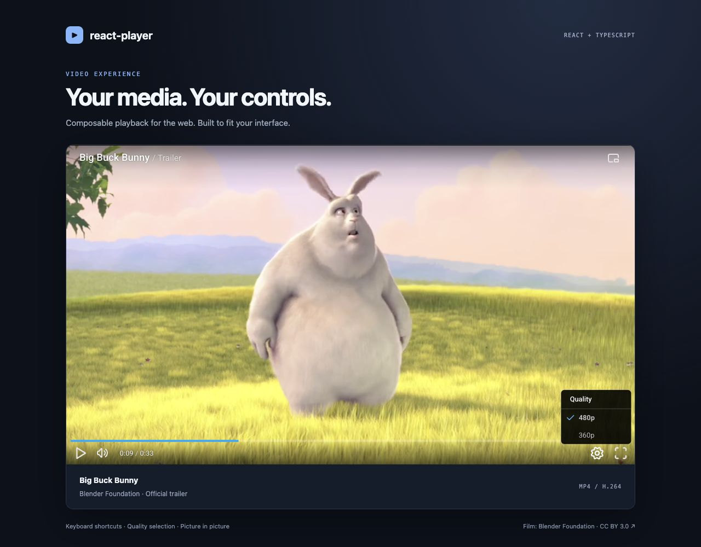
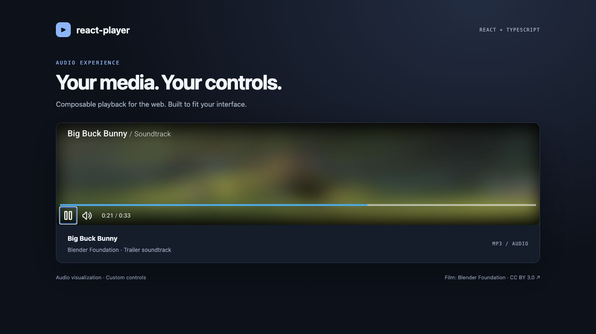

# React Player

**Composable audio and video playback for React.**

Build a player that fits your interface: choose the renderer, arrange the controls,
and connect your own actions with typed hooks. Includes a responsive seek bar,
keyboard shortcuts, manual quality selection, fullscreen, and picture in picture.



[Get started](#run-the-demo) · [Installation](#install-in-your-app) · [Usage](#video-player) · [API](#api-reference) · [Development](#development)

## Features

- **Video and audio** — HTML media elements with an optional audio visualization.
- **Composable UI** — slot headers and controls into `DefaultLayout`, or build your own layout.
- **Playback controls** — play/pause, seeking, volume, timestamps, and playback rate via props.
- **Manual quality selection** — switch between media URLs while retaining the playback position.
- **Keyboard shortcuts** — familiar playback, seeking, volume, and fullscreen keys.
- **Browser integration** — fullscreen and picture in picture where supported.
- **TypeScript** — exported component props, context, and control hooks.

This is `@maeek/react-player`, a separate package from the unscoped `react-player` package.

## Run the demo

Use Node.js 22 LTS and npm. The checked-in lockfile and `.npmrc` preserve the legacy
Storybook dependency setup.

```sh
git clone https://github.com/maeek/react-player.git
cd react-player
nvm use                 # optional, if you use nvm
npm ci
npm start
```

Open **[localhost:6006](http://localhost:6006)** and select a story:

| Story | What it demonstrates |
| --- | --- |
| Video Player | Big Buck Bunny trailer, 480p/360p switching, keyboard controls, fullscreen, and picture in picture |
| Audio Player | The trailer soundtrack with a poster-based audio visualization |
| Custom Controls | A custom “Jump to 00:10” button built with `useMediaControls` |

The demo media is included in `public/media`; no account, API key, or external media
host is required. To choose another port: `npm run storybook -- --port 6007`.

## Install in your app

Requires **React 18.2** and **React DOM 18.2**, plus a browser bundler that handles CSS
imports, such as Vite or webpack. Redux is managed inside the player; you do not need
to add a provider to your application.

### From this checkout

Build a tarball to install the exact version in this repository:

```sh
# In react-player/
npm ci
npm pack

# In your React application, using the path to the generated tarball:
npm install /absolute/path/to/react-player/maeek-react-player-1.1.0.tgz
```

`npm pack` runs the production build automatically and includes JavaScript, CSS,
and type declarations. Demo media is kept out of the package. Copy the files you
want from `public/media` into your application's `public/media` directory to run
the examples below, or substitute your own URLs.

### From GitHub Packages

If you have access to a published version, configure your application's `.npmrc`:

```ini
@maeek:registry=https://npm.pkg.github.com
```

Authenticate to GitHub Packages with an account/token that can read the package,
then install it:

```sh
npm login --scope=@maeek --auth-type=legacy --registry=https://npm.pkg.github.com
npm install @maeek/react-player
```

Availability depends on the published package and your access. Building from the
checkout above works independently of publication. See GitHub's
[npm registry authentication guide](https://docs.github.com/en/packages/working-with-a-github-packages-registry/working-with-the-npm-registry).

## Video player

```tsx
import {
  Player,
  DefaultLayout,
  VideoRenderer,
  HeaderLeft,
  HeaderRight,
  LeftControls,
  RightControls,
  PlayButton,
  VolumeButton,
  Timestamp,
  SeekBar,
  QualitySelector,
  FullscreenButton,
  PictureInPictureButton
} from '@maeek/react-player';

const qualities = [
  { quality: '480p', url: '/media/big-buck-bunny-480p.mp4' },
  { quality: '360p', url: '/media/big-buck-bunny-360p.mp4' }
];

export default function VideoPlayer() {
  return (
    <div style={{ maxWidth: 960, margin: '0 auto' }}>
      <Player
        url={qualities[0].url}
        tag="video"
        poster="/media/big-buck-bunny-poster.jpg"
        qualities={qualities}
        aspectRatio="16:9"
        forceAspectRatio
        preload="metadata"
        keyboardShortcuts
        volume={0.6}
      >
        <DefaultLayout
          renderers={{ video: <VideoRenderer interactive /> }}
          autohide
        >
          <HeaderLeft>Big Buck Bunny / Trailer</HeaderLeft>
          <HeaderRight><PictureInPictureButton /></HeaderRight>
          <SeekBar />
          <LeftControls>
            <PlayButton />
            <VolumeButton />
            <Timestamp />
          </LeftControls>
          <RightControls>
            <QualitySelector />
            <FullscreenButton />
          </RightControls>
        </DefaultLayout>
      </Player>
    </div>
  );
}
```

Component styles are imported with the components. No additional stylesheet import
or Sass loader is needed when consuming the built package.

`Player` supplies state and context. `VideoRenderer` mounts the media element, and
`DefaultLayout` places the controls around it. Keep layout slots (`HeaderLeft`,
`HeaderRight`, `LeftControls`, `RightControls`, and `SeekBar`) as **direct children**
of `DefaultLayout`; its slot detection does not traverse wrapper components or fragments.



Quality entries must point to real encodings of the same content. The player
switches URLs; it does not transcode files or perform adaptive bitrate streaming.

## Audio player



```tsx
import {
  Player, DefaultLayout, AudioRenderer, HeaderLeft,
  LeftControls, PlayButton, VolumeButton, Timestamp, SeekBar
} from '@maeek/react-player';

export default function AudioPlayer() {
  return (
    <Player
      url="/media/big-buck-bunny-audio.mp3"
      tag="audio"
      poster="/media/big-buck-bunny-poster.jpg"
      preload="metadata"
    >
      <DefaultLayout
        renderers={{ audio: <AudioRenderer interactive visualizations /> }}
      >
        <HeaderLeft>Big Buck Bunny / Soundtrack</HeaderLeft>
        <SeekBar />
        <LeftControls>
          <PlayButton />
          <VolumeButton />
          <Timestamp />
        </LeftControls>
      </DefaultLayout>
    </Player>
  );
}
```

The visualization uses Web Audio and changes the poster's opacity in response to
audio levels. Serve audio from your own origin, or use a host that permits CORS.
Start playback with a user gesture so the browser can activate audio.

## Custom controls and integration

Hooks work inside descendants of `Player`. Add your own control to a layout slot:

```tsx
import { useMediaControls, usePlayerControls } from '@maeek/react-player';

function CustomActions() {
  const { play, seek } = useMediaControls();
  const { toggleFullscreen } = usePlayerControls();

  return (
    <>
      <button onClick={() => play(true)}>Play</button>
      <button onClick={() => play(false)}>Pause</button>
      <button onClick={() => seek(10)}>Jump to 00:10</button>
      <button onClick={toggleFullscreen}>Fullscreen</button>
    </>
  );
}

// Inside DefaultLayout:
// <LeftControls><CustomActions /></LeftControls>
```

For native media APIs, obtain the element with `getNodeElement`, or use
`usePlayer().mediaElement` inside a descendant. Keep event handlers stable when
possible: changing lifecycle callbacks reattaches listeners and reapplies the media URL.

```tsx
import { useCallback, useRef } from 'react';
import type { PlayerProps } from '@maeek/react-player';

function usePlaybackTracking() {
  const media = useRef<HTMLVideoElement | HTMLAudioElement | null>(null);
  const getNodeElement = useCallback<NonNullable<PlayerProps['getNodeElement']>>(
    element => { media.current = element; },
    []
  );
  const onTimeUpdate = useCallback(() => {
    const seconds = media.current?.currentTime ?? 0;
    // Save progress or update your application here.
  }, []);

  return { getNodeElement, onTimeUpdate };
}

// In your component:
// const tracking = usePlaybackTracking();
// <Player url="/media/video.mp4" tag="video" {...tracking}>…</Player>
```

### Next.js and server rendering

The package reads browser globals during import and render. Load your entire player
wrapper on the client with SSR disabled. In the App Router, put this in a client component:

```tsx
'use client';

import dynamic from 'next/dynamic';

const VideoPlayer = dynamic(() => import('./VideoPlayer'), { ssr: false });

export default function WatchPage() {
  return <VideoPlayer />;
}
```

`VideoPlayer.tsx` contains the video example above. A `'use client'` directive alone
does not disable server prerendering.

## API reference

### `Player`

| Prop | Type | Default / behavior |
| --- | --- | --- |
| `url` | `string` | Required media URL |
| `children` | `ReactNode` | Required; renderer/layout and controls |
| `tag` | `'video' \| 'audio'` | `'video'`; choose the matching renderer |
| `qualities` | `{ url: string; quality: string }[]` | `[]`; sources for `QualitySelector` |
| `poster` | `string` | Video poster / audio visualization image |
| `autoPlay` | `boolean` | `false`; browser autoplay policy still applies |
| `preload` | `'none' \| 'metadata' \| 'auto'` | Browser behavior when omitted; use `metadata` for demos |
| `volume` | `number` | `1`; clamped to `0–1` when supplied |
| `playbackRate` | `number` | Native default `1`; supplied values clamped to `0.25–15` |
| `aspectRatio` | `string` | E.g. `'16:9'` or `'16x9'`; reserves video space |
| `forceAspectRatio` | `boolean` | Uses the requested ratio instead of loaded dimensions |
| `keyboardShortcuts` | `boolean` | Disabled unless enabled |
| `controls` | `boolean` | Reserved state flag; does not create or hide the composed UI |
| `getNodeElement` | `(element: HTMLVideoElement \| HTMLAudioElement) => void` | Access the mounted media element |

Treat `tag` as fixed for a mounted player. To switch between video and audio, remount
with a different React `key` and the matching renderer.

### Events

| Callback | Arguments |
| --- | --- |
| `onLoadedData`, `onLoadedMetadata`, `onCanPlay` | Native media event |
| `onPlay`, `onPause`, `onTimeUpdate`, `onEnd` | Native media event (`onEnd` maps to `ended`) |
| `onError` | Native `error` or `abort` event |
| `onProgress` | Buffered percentage (`0–100`) for the first buffered range, then native event |
| `onVolumeChange` | Volume (`0–1`), then native event |
| `onFullscreenChange` | Fullscreen boolean, then native event |

Native event arguments are typed as `unknown` in the public interface; narrow them
before accessing event-specific fields. Read current time and duration from the
media element rather than treating `onTimeUpdate` as a numeric callback.

### Components

| Export | Purpose / props |
| --- | --- |
| `DefaultLayout` | `renderers?: { video?: ReactNode; audio?: ReactNode }`, `autohide?: boolean`, slot children |
| `HeaderLeft`, `HeaderRight` | Title/content and header actions |
| `LeftControls`, `RightControls` | Bottom control groups |
| `VideoRenderer` | `interactive?: boolean`; click to toggle play, double-click for fullscreen |
| `AudioRenderer` | `interactive?: boolean`, `visualizations?: boolean` |
| `PlayButton`, `VolumeButton`, `FullscreenButton` | `size?: 'small' \| 'medium' \| 'large'` (default `'medium'`) |
| `PictureInPictureButton` | Button size plus `showLabel?: boolean`, `labelPosition?: 'top' \| 'bottom' \| 'left' \| 'right'` |
| `QualitySelector` | `size` (default `'medium'`); consumes `Player.qualities` |
| `SeekBar` | Seek position and buffered ranges; mouse and touch seeking |
| `Timestamp` | Current time and duration; `format` (default `'H:m:ss'`), `className`, `style` |

### Hooks

| Hook | Returns |
| --- | --- |
| `useMediaControls()` | `play(state?: boolean)` — toggle if omitted; `seek(seconds: number)` |
| `usePlayerControls()` | `toggleFullscreen()` |
| `usePlayer()` | `mediaElement`, `playerElement` refs and optional `videoAspectRatio` |

Useful exported types include `PlayerProps`, `ControlsProps`, `Renderers`,
`VideoRendererProps`, `AudioRendererProps`, `ButtonProps`, and `PlayerContextType`.

### Keyboard shortcuts

Enable with `keyboardShortcuts`. Listeners are attached to the document while the
media element is visible, rather than scoped to focus inside the player.

| Key | Action |
| --- | --- |
| Space / K | Toggle playback |
| ← / → | Seek backward / forward 5 seconds |
| J / L | Seek backward / forward 10 seconds (lowercase) |
| 0–9 | Jump to 0–90% of the duration |
| , / . | Step backward / forward 1/30 second |
| ↑ / ↓ | Increase / decrease volume |
| M | Mute / restore volume |
| F | Toggle fullscreen |

## Styling

The player fills its container. Set the outer wrapper's width and use `aspectRatio`
for video sizing. Colors and font sizes expose CSS custom properties with the
`--ne-` prefix; the complete palettes are in `src/styles/_colors.scss` and
`src/styles/_typo.scss`.

```css
.my-player {
  max-width: 960px;
  --ne-clr-primary-300: #82b7ff;
}
```

The Storybook page styling is demo-only and is not part of the package UI.

## Browser support and current limits

- Media formats and codecs depend on the browser. Use direct, browser-playable URLs.
  YouTube/Vimeo page URLs, DRM, and built-in HLS/DASH engines are not supported.
- Fullscreen, picture in picture, Web Audio, and autoplay are subject to browser support and policy.
- Each player has its own playback state. Enable document-wide shortcuts on only
  one visible player at a time to avoid keyboard conflicts.
- Keyboard shortcuts are document-wide and can intercept keys in form fields.
  Leave them disabled on pages with text input or provide your own focused controls.
- Audio visualization currently has no full AudioContext cleanup for repeated mounts
  or React Strict Mode effect replay. Omit `visualizations` when using that lifecycle.
- The library requires a browser and CSS-aware bundler; it is not a server-side media player.

## Development

| Command | Purpose |
| --- | --- |
| `npm ci` | Install the locked dependency versions |
| `npm start` | Start Storybook on port 6006 |
| `npm run typecheck` | Type-check the library and demo stories |
| `npm run lint` | Check source and story style |
| `npm test -- --runInBand` | Run player-state regression tests with coverage |
| `npm run build` | Build JavaScript, CSS, and declarations into `dist/` |
| `npm run build-storybook` | Build the static demo into `storybook-static/` |
| `npm pack` | Build and create an installable package tarball |

The repository retains its Storybook 7 beta toolchain; dependency upgrades are a
separate maintenance task. The regression suite checks renderer initialization and
independent player state; browser playback is checked separately in the demo.

## Media credits

Demo footage, soundtrack, poster, and screenshot frames: **Big Buck Bunny —
© copyright 2008, Blender Foundation / [www.bigbuckbunny.org](https://www.bigbuckbunny.org/)**.
Used under [Creative Commons Attribution 3.0](https://creativecommons.org/licenses/by/3.0/).
The demo uses resized/re-encoded trailer footage, an extracted soundtrack, and a
poster frame. See [media attribution and source](public/media/ATTRIBUTION.md) and
[Blender's license information](https://peach.blender.org/about/).

No source-code license is currently declared in this repository. The media license
applies to the credited media only.
